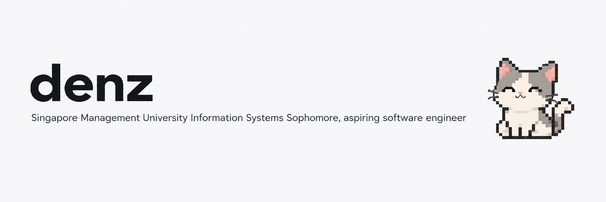
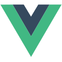

<picture>
  <source media="(prefers-color-scheme: dark)" srcset="./assets/banner-dark.png">
  <source media="(prefers-color-scheme: light)" srcset="./assets/banner-light.png">
  
</picture>

  <a href="https://www.linkedin.com/in/denzelmarani77/"> LinkedIn</a> &nbsp;
  <a href="https://www.instagram.com/thrudenzeyes/"> @thrudenzeyes</a> &nbsp;
  <a href="https://www.instagram.com/thrudenzvision/"> @thrudenzvision</a>

  
  
  
  
  
  
  
  
  
  
  
  
  
  
  
  
  
  
  
  

hiyaa, I'm Denzel — or denz! I'm an Information Systems sophomore at Singapore Management University and an aspiring software engineer. I enjoy building projects, trying new technologies and learning as I go, especially in full-stack development and AI.

I love dabbling and learning about AI and homelabbing -- which I'm fortunate enough to have a headless Ubuntu server home lab!

I'm also interested in cybersecurity, particularly red-teaming. I've hosted and participated in CTFs, and represented SMU's [WhiteHat Society](https://github.com/Whitehat-Society) at DEF CON 2026.

Outside of these technical stuff, you'll often find me with a camera, shooting portraits, cosplay, and events. Do HMU on my socials! My [photography portfolio](https://github.com/asurazxz/photography-portfolio) is in the works XD

ps: I LOVE cats (hence the cat pixelart in my banner)

## Selected work

| Project | Overview |
| --- | --- |
| [Autonomous 2026 Hackathon - Airbus Kalimantan SAF Network Planner](https://github.com/asurazxz/Larpers) | Team entry for Airbus Challenge #3 at Autonomous SG 2026: optimises Kalimantan's biomass-to-airport SAF network, with independent validation and scenario exploration. **Tech:** Python, PuLP, HiGHS, Next.js · [Demo — stored scenarios](https://larpers-steel.vercel.app/) |
| [Agents Orchestrator](https://github.com/asurazxz/agents-ochestrator) | Planned, self-hostable project memory for coding agents across devices, with human-reviewed context and handoffs. Documentation and scaffolding only. **Tech:** Markdown; application stack undecided. |
| [OpenJio](https://github.com/asurazxz/OpenJio) | A desktop-first outing planner for Singapore groups to coordinate availability, vote on stops and share an itinerary. Its `main` branch supports self-hosting with real accounts; a separate `demo` branch provides seeded sample outings. **Tech:** Vue, Vite, Bootstrap, Node.js, Express, Supabase, PostgreSQL, Docker Compose |
| [Photography Portfolio](https://github.com/asurazxz/photography-portfolio) | My creative and technical interests meet in an editorial portfolio with curated galleries and category browsing. Currently uses placeholder imagery. **Tech:** Next.js, React, TypeScript, Tailwind CSS |

---
[My public repos](https://github.com/asurazxz?tab=repositories).
